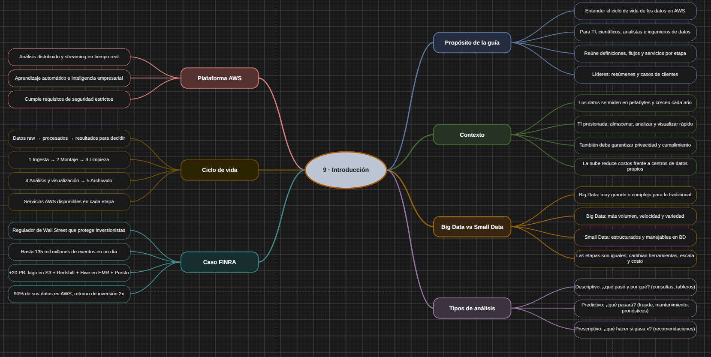
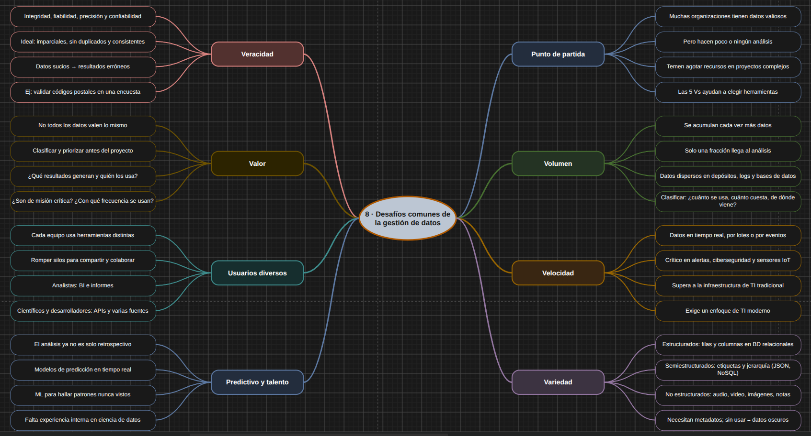
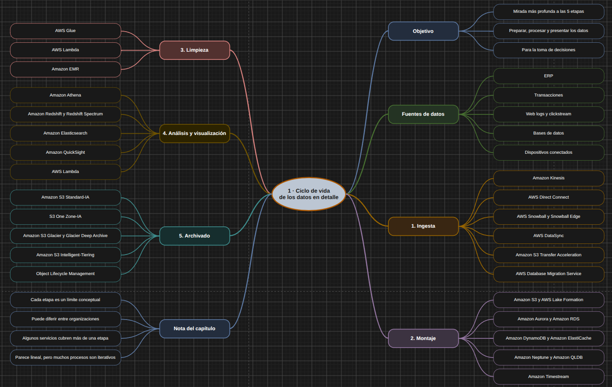
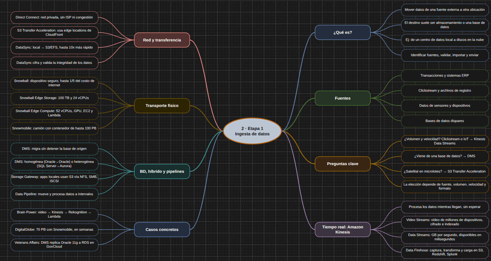

# Mapas mentales – El ciclo de vida de los datos y análisis en la nube de AWS

Este repositorio tiene cuatro mapas mentales hechos a partir del PDF **"AWS – Guía de referencia del ciclo de vida de los datos"** (© 2019, Amazon Web Services). Cada mapa resume **un solo capítulo** de la guía. La información sale únicamente de las páginas de ese capítulo.

| Orden en el PDF | # en la imagen | Capítulo del PDF | Páginas | Imagen |
|---|---|---|---|---|
| 1 | 9 | Introducción (incluye "Propósito de esta guía") | 3–9 | [`img/1_introduccion.png`](img/1_introduccion.png) |
| 2 | 8 | Desafíos comunes de la gestión de datos | 10–13 | [`img/2_desafios_gestion_datos.png`](img/2_desafios_gestion_datos.png) |
| 3 | 1 | El ciclo de vida de los datos en detalle | 14–15 | [`img/3_ciclo_de_vida_en_detalle.png`](img/3_ciclo_de_vida_en_detalle.png) |
| 4 | 2 | Etapa 1 – Ingesta de datos | 16–23 | [`img/4_etapa1_ingesta_de_datos.png`](img/4_etapa1_ingesta_de_datos.png) |

---

## 1. Introducción (págs. 3–9)

La introducción presenta la guía y los conceptos base que se usan en el resto del documento. Termina con un caso real.

- **Propósito de la guía:** ayudar a entender el ciclo de vida de los datos en AWS. Está escrita para personal de TI y para científicos, analistas e ingenieros de datos, y reúne definiciones, flujos de trabajo y servicios por etapa. Los líderes de negocio pueden apoyarse en los resúmenes y en los casos de clientes.
- **Contexto:** los datos se miden en petabytes y crecen cada año. TI está presionada para almacenar, analizar y visualizar rápido, y al mismo tiempo garantizar la privacidad y el cumplimiento. Frente a tener centros de datos propios, la nube reduce costos.
- **Big Data vs Small Data:**
  - *Big Data:* datos demasiado grandes o complejos para las herramientas tradicionales, con más volumen, velocidad y variedad.
  - *Small Data:* datos estructurados que se manejan bien en las bases de datos existentes.
  - En los dos casos las etapas del ciclo son las mismas. Lo que cambia son las herramientas, la escala y el costo.
- **Tipos de análisis:**
  - *Descriptivo:* responde qué pasó y por qué, con consultas y tableros.
  - *Predictivo:* estima qué va a pasar, por ejemplo para detectar fraude, planear mantenimiento o hacer pronósticos.
  - *Prescriptivo:* responde qué hacer si pasa algo, como hacen los motores de recomendación.
- **Plataforma AWS:** ofrece lagos de datos y almacenes de big data, análisis distribuido, *streaming* en tiempo real, aprendizaje automático e inteligencia empresarial, y cumple requisitos de seguridad estrictos.
- **Ciclo de vida:** los datos pasan de crudos (*raw*) a procesados y de ahí a resultados para tomar decisiones. Esto ocurre en cinco etapas: 1 Ingesta, 2 Montaje, 3 Limpieza, 4 Análisis y visualización, y 5 Archivado. AWS tiene servicios para cada una.
- **Caso FINRA:** el regulador de Wall Street que protege a los inversionistas. Ha llegado a procesar hasta 135 mil millones de eventos en un día y maneja más de 20 PB de datos. Usa un lago de datos en S3 junto con Redshift, Hive en EMR y Presto. Tiene el 90 % de sus datos en AWS y obtuvo un retorno de inversión de 2x.

**Idea clave para exponer:** sin importar si los datos son grandes o pequeños, todos pasan por las mismas cinco etapas, y la nube permite cubrirlas de forma más barata y escalable.

---

## 2. Desafíos comunes de la gestión de datos (págs. 10–13)

El capítulo explica **por qué a las organizaciones les cuesta sacarle valor a sus datos**. Ordena los problemas según las **cinco Vs** de la gestión de datos (volumen, velocidad, variedad, veracidad y valor) y añade otros dos retos: la diversidad de usuarios y el paso al análisis predictivo.

- **Punto de partida:** muchas organizaciones tienen datos valiosos pero hacen poco o ningún análisis, porque temen agotar sus recursos en proyectos complejos. Las cinco Vs ayudan a decidir qué herramientas hacen falta.
- **Volumen:** cada vez se acumulan más datos, pero solo una fracción llega a analizarse. Además están dispersos en depósitos, logs y bases de datos. Por eso hay que clasificarlos: saber cuánto se usa, cuánto cuesta guardarlo y de dónde viene.
- **Velocidad:** los datos llegan en tiempo real, por lotes o por eventos. Esto es crítico en alertas de emergencia, ciberseguridad y sensores IoT, supera a la infraestructura de TI tradicional y exige un enfoque de TI moderno.
- **Variedad:**
  - *Estructurados:* filas y columnas en bases de datos relacionales.
  - *Semiestructurados:* tienen etiquetas que marcan una jerarquía, como JSON o NoSQL.
  - *No estructurados:* audio, video, imágenes o notas. Necesitan metadatos para poder buscarlos, y si no se usan se convierten en **datos oscuros**.
- **Veracidad:** se refiere a la integridad, fiabilidad, precisión y confiabilidad de los datos. Lo ideal es que sean imparciales, sin duplicados y consistentes, porque los datos sucios llevan a resultados erróneos. El ejemplo del PDF es validar los códigos postales de una encuesta.
- **Valor:** no todos los datos valen lo mismo, así que hay que clasificarlos y priorizarlos antes de empezar el proyecto. Las preguntas a hacerse son qué resultados generan, quién los usa, si son de misión crítica y con qué frecuencia se necesitan.
- **Usuarios diversos:** cada equipo usa herramientas distintas y hay que romper los silos para compartir y colaborar. Los analistas suelen usar BI para hacer informes, mientras que los científicos y desarrolladores usan APIs y varias fuentes.
- **Predictivo y talento:** el análisis ya no es solo retrospectivo. Ahora se buscan modelos que predigan en tiempo real y se usa ML para encontrar patrones nunca vistos, pero muchas organizaciones no tienen experiencia propia en ciencia de datos.

**Idea clave para exponer:** las cinco Vs resumen el problema, y entenderlas permite elegir la herramienta adecuada en cada etapa del ciclo.

---

## 3. El ciclo de vida de los datos en detalle (págs. 14–15)

Este capítulo es una **vista general** de las cinco etapas por las que pasan los datos. Para cada etapa muestra los servicios de AWS que se usan, sin entrar a explicarlos; eso lo hacen los capítulos de cada etapa.

- **Objetivo:** mirar más a fondo las cinco etapas que intervienen en *preparar, procesar y presentar* los datos para la toma de decisiones.
- **Fuentes de datos:** ERP, transacciones, web logs y clickstream, bases de datos y dispositivos conectados.
- **1. Ingesta:** Amazon Kinesis, AWS Direct Connect, AWS Snowball y Snowball Edge, AWS DataSync, Amazon S3 Transfer Acceleration y AWS Database Migration Service.
- **2. Montaje:** Amazon S3, AWS Lake Formation, Amazon Aurora, Amazon RDS, Amazon DynamoDB, Amazon ElastiCache, Amazon Neptune, Amazon QLDB y Amazon Timestream.
- **3. Limpieza:** AWS Glue, AWS Lambda y Amazon EMR.
- **4. Análisis y visualización:** Amazon Athena, Amazon Redshift y Redshift Spectrum, Amazon Elasticsearch, Amazon QuickSight y AWS Lambda.
- **5. Archivado:** Amazon S3 Standard-IA, S3 One Zone-IA, Amazon S3 Glacier, S3 Glacier Deep Archive, S3 Intelligent-Tiering y Object Lifecycle Management.
- **Nota del capítulo:** cada etapa es un límite conceptual y puede cambiar de una organización a otra. Algunos servicios sirven en más de una etapa (por ejemplo, Lambda aparece en limpieza y en análisis). Y aunque el ciclo parece lineal, muchos procesos de análisis e ingeniería de datos son **iterativos**.

**Idea clave para exponer:** el ciclo va de las fuentes a la ingesta, luego al montaje, la limpieza, el análisis y el archivado, y AWS tiene servicios para cada paso.

---

## 4. Etapa 1 – Ingesta de datos (págs. 16–23)

La ingesta es el primer paso del ciclo: **llevar los datos desde donde se generan hasta la nube** para poder analizarlos. El mapa se lee en tres partes. Primero, qué es la ingesta y de dónde vienen los datos. Después, cómo se elige el servicio. Y por último, los servicios agrupados según la necesidad, con casos reales.

- **¿Qué es?** Es el movimiento de datos desde una fuente externa a otra ubicación, que normalmente es un almacenamiento o una base de datos. Un ejemplo es pasar los datos de un centro de datos local a discos virtuales en la nube. El proceso consiste en identificar las fuentes correctas, validar e importar los archivos y enviarlos al destino.
- **Fuentes:** transacciones, sistemas ERP, clickstream, archivos de registro, sensores y dispositivos, y bases de datos dispares.
- **Preguntas clave:** el servicio se elige según la fuente, el volumen, la velocidad y el formato de los datos.
  - Para clickstream, ERP o IoT, con alto volumen y velocidad, se usa **Kinesis Data Streams**.
  - Si los datos vienen de una base de datos, se usa **DMS**.
  - Para datos satelitales en microlotes, se usa **S3 Transfer Acceleration**.
- **Tiempo real con Amazon Kinesis:** procesa los datos a medida que llegan, sin esperar a tenerlos todos.
  - *Video Streams:* recibe video de millones de dispositivos y lo almacena, cifra e indexa.
  - *Data Streams:* captura gigabytes por segundo y deja los datos disponibles en milisegundos.
  - *Data Firehose:* captura, transforma y carga los datos en S3, Redshift, Elasticsearch o Splunk.
- **Red y transferencia:**
  - *Direct Connect:* una red dedicada y privada que no pasa por el proveedor de internet.
  - *S3 Transfer Acceleration:* transfiere a larga distancia usando las *edge locations* de CloudFront.
  - *DataSync:* copia de servidores locales a S3 o EFS hasta 10 veces más rápido, y cifra y valida la integridad de los datos.
- **Transporte físico:** se usa cuando hay tantos datos que enviarlos por internet sale demasiado caro o lento.
  - *Snowball:* cuesta hasta una quinta parte de lo que costaría la transferencia por internet.
  - *Snowball Edge Storage Optimized:* 100 TB y 24 vCPU.
  - *Snowball Edge Compute Optimized:* 52 vCPU y GPU opcional; puede ejecutar EC2 y Lambda.
  - *Snowmobile:* un contenedor de 45 pies en un camión, con capacidad para hasta 100 PB.
- **BD, híbrido y pipelines:**
  - *DMS:* migra la base de datos sin detener la de origen. La migración puede ser homogénea (de Oracle a Oracle) o heterogénea (de SQL Server a Aurora).
  - *Storage Gateway:* permite que las aplicaciones locales usen el almacenamiento de AWS por NFS, SMB o iSCSI.
  - *Data Pipeline:* mueve y procesa datos entre servicios a intervalos definidos.
- **Casos concretos:**
  - *Brain Power:* el video va a Kinesis Video Streams, luego a Rekognition, y Lambda calcula las métricas de atención.
  - *DigitalGlobe:* movió 70 PB con Snowmobile en semanas en vez de meses.
  - *Veterans Affairs:* usa DMS para replicar 20 millones de registros de Oracle 11g a RDS en GovCloud.

**Idea clave para exponer:** no hay un único servicio de ingesta; se escoge según el volumen, la velocidad, el origen y el formato de los datos.

---

## Orden de la exposición

Los mapas siguen el orden del PDF: **Introducción (9) → Desafíos (8) → Ciclo de vida en detalle (1) → Etapa 1 – Ingesta (2)**. Ese orden cuenta la historia completa: primero el contexto, luego el problema, después el panorama general y al final la primera etapa en detalle.

## Fuente

Amazon Web Services (2019). *El ciclo de vida de los datos y análisis en la nube de AWS – Guía de referencia.* © 2019, Amazon Web Services, Inc. or its affiliates.
